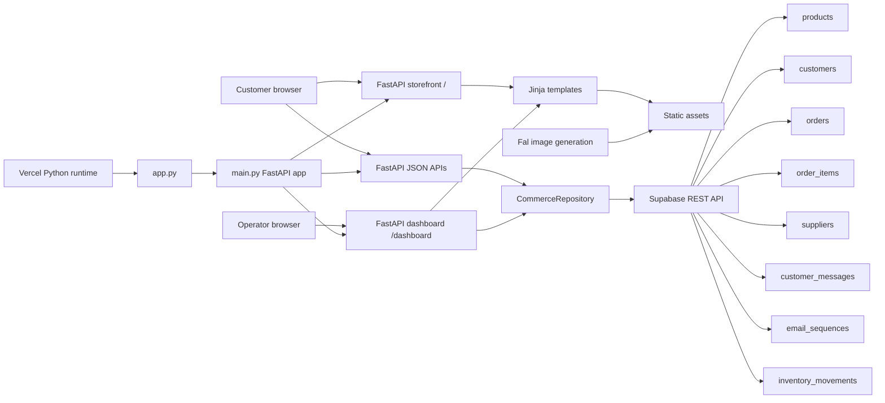
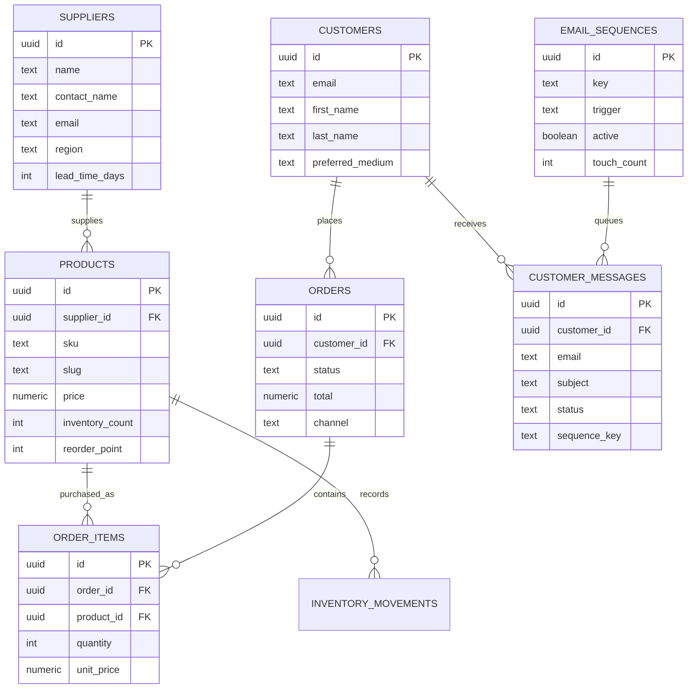

# Atelier Bristle Architecture

## Runtime Flow

1. Customers browse `/`, add products to the browser cart and submit a reservation through `/api/orders`.
2. FastAPI validates the cart, reads current inventory and writes customer, order, order item and queued communication records to Supabase.
3. The dashboard reads aggregate order, product, supplier, message and sequence data through the same server-side repository.
4. Vercel serves `app.py`, which imports the FastAPI app from `main.py`.
5. Fal-generated imagery is stored locally in `static/generated/` and served by FastAPI static files.
